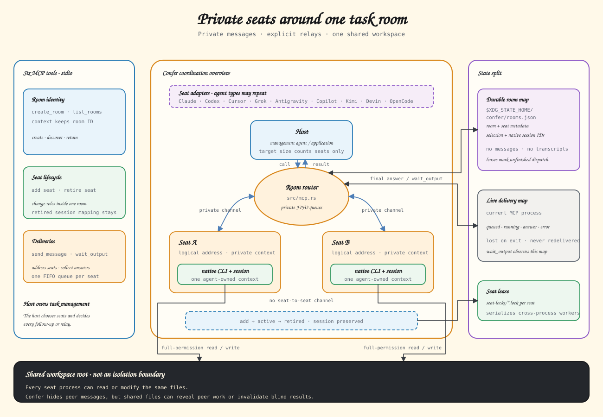

# Confer Design

## Product definition

Confer is a local MCP server for running and resuming installed coding agents. A coding agent or another application can integrate through MCP and manage task decomposition, relays, and result acceptance. It is a standalone Rust binary and has no dependency on Recall, Orca, or a daemon.



## Supported participants and hosts

The following products can act as external room participants and as MCP hosts:

| ID | Product | Participant command | MCP registration |
| --- | --- | --- | --- |
| `claude` | Claude Code | `claude` | native `claude mcp` command |
| `codex` | Codex | `codex exec` | native `codex mcp` command |
| `cursor` | Cursor Agent | `agent` or `cursor-agent` | `~/.cursor/mcp.json` |
| `grok` | Grok Build | `grok` | native `grok mcp` command |
| `agy` | Antigravity CLI (alias: `gemini`; Gemini models use this seat via the `model` field) | `agy` | native `agy mcp` command |
| `copilot` | GitHub Copilot CLI | `copilot` | native `copilot mcp` command |
| `kimi` | Kimi Code | `kimi` | `$KIMI_CODE_HOME/mcp.json` (default `~/.kimi-code/mcp.json`) |
| `devin` | Devin for Terminal | `devin` | native `devin mcp` command |
| `opencode` | OpenCode | `opencode` | `$XDG_CONFIG_HOME/opencode/opencode.json` (default `~/.config/opencode/opencode.json`) |

MCP and Skill installation also support these hosts. They do not become seat adapters.
All MCP entries below use JSON with a top-level `mcpServers` object and a `command` string plus an `args` array.
Skill paths are roots containing `confer/SKILL.md`; Kitup selects an existing supported root before the first default root.

| Host ID | Product | User MCP configuration | User / project Skill roots | Official references |
| --- | --- | --- | --- | --- |
| `gemini-cli` | Google Gemini CLI | `$GEMINI_CLI_HOME/.gemini/settings.json` (default `~/.gemini/settings.json`) | `~/.gemini/skills` or `~/.agents/skills` / `.agents/skills` or `.gemini/skills` | [Configuration](https://geminicli.com/docs/reference/configuration/), [MCP](https://geminicli.com/docs/tools/mcp-server/), [Skills](https://geminicli.com/docs/cli/skills/) |
| `qwen` | Qwen Code | `$QWEN_HOME/settings.json` (default `~/.qwen/settings.json`) | `~/.qwen/skills` / `.qwen/skills` | [Configuration](https://qwenlm.github.io/qwen-code-docs/en/users/configuration/settings/), [MCP](https://github.com/QwenLM/qwen-code/blob/main/docs/developers/tools/mcp-server.md), [Skills](https://qwenlm.github.io/qwen-code-docs/en/users/features/skills/) |
| `droid` | Factory Droid | `~/.factory/mcp.json` | `~/.factory/skills` / `.factory/skills` | [MCP](https://github.com/Factory-AI/factory/blob/main/docs/cli/configuration/mcp.mdx), [Skills](https://github.com/Factory-AI/factory/blob/main/docs/cli/configuration/skills.mdx) |
| `qoder` | Qoder CLI | `$QODER_CONFIG_DIR/settings.json` (default `~/.qoder/settings.json`) | `~/.qoder/skills` / `.qoder/skills` | [Configuration](https://docs.qoder.com/cli/settings-reference), [MCP](https://docs.qoder.com/cli/mcp-reference), [Skills](https://docs.qoder.com/cli/Skills) |
| `kiro` | Kiro IDE and CLI | `~/.kiro/settings/mcp.json` | `~/.kiro/skills` / `.kiro/skills` | [MCP](https://kiro.dev/docs/mcp/configuration/), [Skills](https://kiro.dev/docs/skills/) |

`gemini-cli` selects Google Gemini CLI. The existing `gemini` alias still selects Antigravity (`agy`).
Droid and Qoder entries include `type: "stdio"`. The other added hosts use their default stdio transport without a `type` field.
Qwen expands a leading `~/` in `QWEN_HOME` and resolves relative paths from the current directory.
When `GEMINI_CLI_HOME`, `QWEN_HOME`, or `QODER_CONFIG_DIR` is set, user Skill installation uses that configuration directory's `skills` subdirectory through Kitup.
Kitup host specifications require user paths inside `HOME`. An override outside `HOME` fails before installation instead of writing to the default path.
Auto selection validates overrides only for detected hosts. An absent host with an external override does not block other installations.
Project Skill paths and explicitly selected unrelated hosts stay unchanged.
Kiro custom agents may need MCP configuration inclusion and Skill resource URIs enabled in their agent configuration. Installation does not change those settings.

MCP is the public protocol. Every seat uses an ACP v1 lifecycle internally. Cursor, Grok, Copilot, Kimi Code, and OpenCode use native ACP over stdio; Codex uses an in-process ACP bridge to its app-server; Claude, Antigravity, and Devin use in-process ACP bridges to their native headless commands. Confer ships one Rust binary and requires no separate bridge runtime.

## Room model

A room belongs to one normalized workspace supplied explicitly by the host task, never inferred from the MCP process working directory. The input must be an absolute path to an existing directory. Creation and current-workspace discovery normalize a Git directory to the canonical result of `git rev-parse --show-toplevel`. Different Git worktrees are different workspaces. Outside Git, the canonical supplied directory is the workspace.

The host verifies the returned root against its own task before using it for subsequent room calls. Existing-room operations canonicalize the supplied root and require it to match the stored room workspace; they do not rediscover a Git root or retarget the room. Symlink aliases of the same root are accepted. Workspace matching prevents accidental cross-project routing, not filesystem access by a malicious caller.

Workspace discovery and participant processes both ignore inherited `GIT_DIR` and `GIT_WORK_TREE`. All participant transports start in the verified room root; changing the MCP server's launch environment cannot redirect these Git location variables into a different project.

The host manages the work and is not an execution seat. In coding-agent workflows, the host acts as the management agent; applications may implement that role in code. At creation, `target_size` requests execution seats only. It must be positive when supplied. There is no default count or fixed seat limit: provide `target_size`, at least one explicit seat, or both. Creation uses the larger of `target_size` and the explicit seat count, and `add_seat` may grow the room later.

A seat has an independent ID, room address, and native session mapping. Agent, model, and reasoning effort are configuration fields, not a unique identity. Multiple seats may use identical configurations, and the number of seats is not limited by the number of installed agent types.

A room is a coordination context whose reuse is decided by the caller. Workspace matching does not imply automatic reuse. The bundled Skill guides coding-agent hosts to reuse a room from their current session context and to discover historical rooms only when the user asks to continue one; applications may supply their own workflow.

Rooms may add seats as new roles become useful and retire seats whose role is complete. Retiring a seat preserves its metadata and native session mapping but permanently removes it from direct, multicast, and broadcast addressing.

Each external seat has these optional selection fields:

```json
{
  "agent": "codex",
  "model": "gpt-5.6-sol",
  "reasoning_effort": "high",
  "name": "planner",
  "instructions": "Design the change. Do not edit files."
}
```

`name` is a room address, not a built-in role. `instructions` are visible only to that seat. Every delivery includes those stable instructions and the current message, including when resuming a session whose first prompt failed. A recorded native session ID does not imply that instructions were delivered. Confer generates a unique seat name when none is supplied.

Rooms have no lifecycle status, automatic expiration, or garbage collection. A persisted room remains addressable by ID in its workspace. Starting a new room does not change or delete earlier rooms.

## Local state

Confer stores disposable room metadata and advisory seat lease files:

```text
$XDG_STATE_HOME/confer/rooms.json
$XDG_STATE_HOME/confer/rooms.json.lock
$XDG_STATE_HOME/confer/seat-locks/*.lock
```

On macOS and Linux, `XDG_STATE_HOME` must be an absolute path. An unset, empty, or relative value falls back to `~/.local/state`. The legacy `~/.confer` directory is neither read nor migrated; existing files remain untouched. Restart all Confer MCP processes after upgrading. Native agent sessions remain in their original stores.

`rooms.json` contains a schema version and room records with:

- room ID, name, workspace root, and timestamps;
- originating host identity when known;
- external seat identity and selection fields;
- external seat active or retired status;
- native agent session ID and adapter recovery fields when a session has started.

These files do not contain message bodies, agent replies, queued messages, delivery status, full transcripts, tool calls, thinking, or code snapshots. A seat lease file holds the current delivery ID from the moment its worker takes the lease until that delivery returns; it contains no message content. Native agent stores remain the source of truth for conversation history.

Room metadata writes use a short advisory lock and atomic replacement. Current writes use schema version 3; versions 1 and 2 remain readable and normalize on the next mutation, while unknown newer versions fail closed. Removing the disposable room cache resets Confer discovery without deleting native agent sessions.

## Readiness and selection

Readiness checks are local and run when a room is created, when a seat is added, and before each delivery starts. They inspect the executable and local authentication or configuration state without calling a model or checking quota. OpenCode requires only an executable because Zen free models can work without login; paid provider credentials and model availability are checked by OpenCode at delivery time. A positive result means `locally_ready`; it does not guarantee provider availability, model access, or remaining quota.

Creation and seat addition validate the final selected agent's deterministic configuration before saving any room change. Delivery uses the same validation. Malformed Cursor model options, conflicting option sources, and unsupported local effort values fail immediately. Model availability and provider-specific capabilities remain native runtime checks. Cursor accepts `reasoning_effort` without `model` and applies it to its configured default model; a default that does not support that effort returns a native error. Copilot applies `model` and then `reasoning_effort` through ACP session configuration options; a model or effort its session does not offer returns a native error. Kimi Code applies `model` and then `reasoning_effort` (`thinking`) through ACP session configuration options; a model or effort its session does not offer returns a native error. OpenCode applies `mode=build`, then `model`, then `reasoning_effort` (`effort`) through ACP session configuration options. Effort values are the selected model's variants, such as `low`, `high`, `max`, or `default`, and pass through unchanged; a value the model does not offer returns a native error. Model IDs pass through unchanged. Devin applies `model` through `devin --model` and rejects `reasoning_effort` outright.

The host may specify all, some, or none of the seats. For unspecified agents and remaining target positions, Confer cycles through locally ready supported agents, placing agent types other than the known host first. Agent types may repeat; the host's agent type remains eligible. Explicit agent choices are honored. A seat that sets `model` or `reasoning_effort` must also set `agent`. Confer does not infer an agent from a model name. Creation and seat addition fail before changing room state.

If an explicitly requested agent is unavailable, creation or seat addition fails with the agent, seat, and readiness reason. The operation does not modify room state. Confer does not choose a replacement or discard the requested model and effort. The caller decides whether to submit a new request with another agent; personal Skills may guide that decision.

## Session lifecycle

`create_room` creates logical seats only. It performs no model call and does not start empty agent sessions.

The first queued message to an external seat creates its native session and records the native session ID. Every seat has one in-process FIFO worker. A sent message enters that worker, starts promptly when the seat is idle, and remains `queued` while an earlier delivery runs. Different seats may run concurrently. A cross-process file lease serializes workers from separate MCP processes, but FIFO ordering is guaranteed only within one live MCP process. Queue processing does not retry a native message after dispatch may have begun.

Delivery tracking, queued messages, and results live only in the MCP process and are lost when it exits. Native work can continue. Adapters save a native session ID as soon as they observe it, through the existing room cache. CLI adapters observe IDs in output. Devin observes its ID in the ATIF export. Replies remain outside Confer state.

A non-empty, unlocked seat lease marks `previous_delivery_uncertain: true`. Confer refuses sends to that seat. It checks again under the lease before dispatch, including for already queued messages. Refusals include `uncertain_delivery_id` and `resume_command`. The command is null for Cursor or an unknown session ID.

Inspect native work, then call `clear_uncertain_delivery` with that ID. Clearing neither dispatches nor retries a message. A later explicit send resumes the recorded session or creates one if no ID exists. Confer never automatically redelivers uncertain work. Removing the room cache resets discovery without deleting native sessions.

## Message visibility

Each seat has a private native session, sees only addressed messages, and returns replies to the current host. Multicast and broadcast send independent copies to selected or all external seats; seats see neither the room transcript nor peer replies. Only the host can relay, so Confer never starts an unbounded agent-to-agent loop.

## MCP tools

The public MCP surface contains eight tools. Calls require the verified `workspace`, except `list_rooms` with `scope: all`. Update callers and the bundled Skill together, restart MCP connections, and refresh schemas after upgrading. `target_size` excludes the host. Creation requires a target size or explicit seats. Unavailable choices fail without replacement. The room cache format and existing room workspaces are unchanged.

### `create_room`

Creates a room for the host task's supplied workspace.

Input:

- `workspace`: required absolute directory from the current host task;
- `name`: optional human-readable room name;
- `target_size`: optional positive execution seat count, excluding the host; no default or fixed upper bound;
- `host_agent`: optional current host ID when automatic detection is unavailable;
- `seats`: optional external seat specifications.

Output includes the room ID, normalized workspace, roster, and readiness results. It never sends a task.

### `add_seat`

Adds one private seat using `room_id`, the host-verified workspace root in `workspace`, and `seat`. The seat uses the same agent, model, effort, name, and instruction fields as room creation. Existing and retired seat names remain reserved. Output includes the updated room and readiness results.

### `retire_seat`

Retires one seat by name or ID using `room_id`, `seat`, and the host-verified workspace root in `workspace`. A busy seat returns `seat_busy`. Retirement preserves the native session mapping but is irreversible.

### `list_rooms`

Lists rooms. `scope` defaults to `current`, which requires the host task's absolute directory in `workspace` and normalizes it like creation. `all` returns metadata for every recorded workspace without requiring a workspace or inspecting the MCP process working directory. The bundled Skill uses this when the user explicitly asks to recover an earlier room; other callers decide their own discovery workflow. Discovery does not authorize operating on rooms outside the host task's workspace.

Output includes room ID, name, participants, native-session availability, and timestamps. Each seat includes `resume_command`, `previous_delivery_uncertain`, and `uncertain_delivery_id`. It never returns message content.

### `send_message`

Sends one message to one seat, selected seats, or all external seats.

Input:

- `room_id`;
- `workspace`: the host-verified workspace root;
- `recipients`: one or more seat names or IDs, or `*` for broadcast;
- `message`.

Each recipient gets a receipt and `delivery_id` for `wait_output`. Receipts include `accepted`, `error`, `previous_delivery_uncertain`, `uncertain_delivery_id`, and `resume_command`. An uncertain seat returns `accepted: false` without queueing. Use `wait_output` for delivery status.

### `clear_uncertain_delivery`

After inspecting native work, supply `room_id`, verified `workspace`, seat name or ID in `seat`, and the observed `uncertain_delivery_id` in `delivery_id`. A busy seat returns `seat_busy`. A changed marker fails without clearing it. An empty marker is already clear. Output contains room metadata. This action sends no message.

### `cancel_delivery`

Cancels deliveries known to the current live MCP process. Requires `room_id`, the host-verified workspace root in `workspace`, and a nonempty `delivery_ids` list. The scope matches `wait_output`.

The result contains one delivery entry per requested ID, in input order. Queued deliveries become `cancelled` and never dispatch. Running ACP deliveries receive `session/cancel`. Running Codex deliveries receive `turn/interrupt`. Claude, Antigravity, and Devin bridges terminate their process group on Unix. If a native cancellation does not finish within three seconds, Confer terminates the child process group on Unix.

Native cancellation preserves the existing adapter lifecycle and lets the agent acknowledge the end of its turn. Unconditional process termination is the simpler alternative, but it provides no native completion response. Confer uses it only for CLI bridges and native cancellation timeouts.

Each adapter starts in a separate process group on Unix. Forced termination kills that group. For every cancellation, Confer scans and stops tool descendants before it disconnects the Agent, including when the Agent acknowledges native cancellation. Forced termination also scans and terminates descendant groups, including separate shell tool groups. Each scan has a one-second limit. A failed scan marks the result uncertain. A `cancelled` result only confirms that the process tree Confer can track stopped. Detached or reparented processes, such as background daemons or development servers, can continue running. The host must inspect these processes separately. On non-Unix platforms, termination stops only the direct child. Descendant termination is not guaranteed there.

After forced termination, Confer waits up to three seconds for the child to exit. The tool waits up to eight seconds for adapter cleanup and session persistence. If cleanup exceeds that limit, it returns `timed_out: true` and `previous_delivery_uncertain: true` for unfinished deliveries. Those deliveries remain `running` until cleanup finishes. Confer releases the seat lease before it returns `cancelled`. If process termination or reaping fails, the result reports `previous_delivery_uncertain: true`. This flag means native work is not confirmed stopped, even when the delivery is `cancelled`. A partial answer, when available, has `answer_incomplete: true`. An adapter or persistence error remains available in `error`. Finished deliveries keep their current status and output. Confer marks an answer complete at ACP `end_turn`, Codex `turn/completed`, or a final CLI result. Later cancellation during close, unsubscribe, or process reaping cannot change that answer to `cancelled` or incomplete. Unknown IDs use the same unknown or expired delivery error as `wait_output`.

Cancellation does not retire the seat or undo side effects. Queued deliveries proceed only if cleanup leaves no uncertain marker. Otherwise, they fail before dispatch. Inspect native work, then clear the marker before sending again. Later sends resume the recorded session. If no ID was observed, the cancellation result explains that the next explicit send creates a new native session.

### `wait_output`

Waits for specified deliveries or the room’s current live deliveries. Requires `room_id` and the host-verified workspace root in `workspace`. `timeout_ms` defaults to `120000`, accepts `0` for an immediate snapshot, and is capped at `600000`.

Output includes delivery status, final answer, error, and `resume_command`. Status is `queued`, `running`, `completed`, `failed`, `cancelled`, or `awaiting_answer`. A resume command enters the workspace and opens the native session interactively. Cursor ACP sessions are separate from CLI chats and return no command. Do not resume while that seat has queued or running deliveries: two processes can write the same session. Thinking, token deltas, and intermediate tool events are excluded. A timeout returns current results without cancellation. `cancelled` is terminal. `answer_incomplete: true` marks a partial answer.

For a Codex or Cursor question, Confer stops the native turn through native cancellation and returns the question in `question`. After a clean question-triggered stop, `awaiting_answer` is terminal; `completed` is true. Caller cancellation stays `cancelled`. The host must supply an answer as a new message to the same seat. No native question request remains open. Confer neither fabricates an answer nor skips the question. Failed cleanup preserves the question and error and can leave uncertainty. Questions are lost on MCP exit.

## CLI surface

The CLI exists to serve and install the MCP and bundled Skill:

```text
confer mcp
confer mcp capabilities
confer mcp install [--agent <id>]... [--dry-run] [--bin <path>]
confer mcp uninstall [--agent <id>]... [--dry-run]
confer skill install [--scope user|project] [--agent <id>]... [--dry-run] [--yes]
```

`confer mcp` serves stdio MCP. Room operations are not exposed as ordinary CLI commands.

MCP and Skill installation are deliberately independent. `confer mcp install` never installs the Skill, and `confer skill install` never changes MCP configuration. Both installation commands support the same fourteen hosts in the two tables.

`confer skill install` embeds the [canonical Skill](../skills/confer/SKILL.md) and delegates target paths, conflict protection, updates, scope, and dry-run reporting to Kitup. User scope is the default. In a non-interactive shell, specify `--scope user` or `--scope project`, or use `--yes` to accept user scope.

`confer mcp install` follows each host’s supported registration mechanism. Repeated installation updates the Confer-owned registration without deleting unrelated MCP entries. Uninstall removes only the `confer` entry.

Explicit selection of a file-based host edits its user MCP configuration without requiring its CLI on `PATH`.
This applies to Cursor, Kimi Code, OpenCode, and all five additional hosts in the second table.
Default selection and `--agent '*'` discover executables on `PATH`: `gemini`, `qwen`, `droid`, `qoder` or `qodercli`, and `kiro-cli` or `kiro` for the added CLI hosts.
The six existing native-command hosts still require their CLI on `PATH`.
File registration accepts JSON. Invalid JSON, comments, and malformed install targets fail without changing the file.
Existing non-stdio `confer` entries are not replaced or removed. Existing stdio entry options and unrelated configuration remain intact.
Registration does not establish participant readiness or authentication. Restart the host or reload its MCP configuration after installation.

OpenCode registration writes a local MCP entry with a command array and `enabled=true`, preserving unrelated configuration.
OpenCode sets `OPENCODE=1` on inherited MCP processes, which Confer uses for host detection.
The added hosts need no seat exclusion because they have no seat adapter. They can supply their ID in `create_room.host_agent`.
MCP installation does not change host detection or seat selection.
Default Skill selection requires `gemini` on `PATH` for Google Gemini CLI, matching MCP discovery.
The shared `~/.gemini` directory alone does not select Google Gemini CLI. Explicit `--agent gemini-cli` does not require its executable.

## Adapter contract

Confer prepends this fixed preamble to every delivery, before any seat instructions and the message:

> Do not call Confer MCP tools. Respond directly to the room host. If a required task premise proves false or the requested action conflicts with observed code or facts, stop. Report the conflict and evidence to the host instead of working around it.

This instructs the seat to stop and report conflicting evidence. Confer does not enforce the seat's compliance.

Every adapter must:

- resolve its supported executable without scanning unrelated agents;
- perform a local readiness check without a model call;
- create a native session on first send and capture its stable ID;
- resume exactly that session for later messages;
- pass the selected model and reasoning effort when supported;
- run in the room’s stored workspace root;
- extract the final assistant answer from machine-readable output;
- preserve stderr for actionable errors without leaking credentials, and return native failures without retry or fallback.

Confer owns the FIFO Queue above every adapter. Each queued delivery opens one ACP connection, runs one native agent process, and resumes the seat's recorded native session when one exists. Session history replay is excluded from the current answer. After a terminal response, Confer closes the connection and reaps its child. Without cancellation, native ACP, Codex, and Devin reap paths kill only the direct child if it remains alive after three seconds. They then wait for that child to exit. Claude and Antigravity bridges read through stdout EOF and wait for natural exit without this timeout. Process-group and descendant cleanup apply only to cancellation. The worker waits for the previous adapter and session persistence to return before it dispatches the next delivery. A tool timeout does not bypass that wait. Uncertain native work can remain unconfirmed after the adapter returns. There is no idle process pool.

Cursor seats use its ACP session store. Old headless Cursor session IDs are not migrated and require new seats. Copilot seats use its native session store through ACP `session/load`; replayed history is excluded from the current answer. Kimi Code and OpenCode seats use native ACP `session/resume`. Devin seats resume with `devin --resume` against the session ID read from its per-delivery ATIF export. Other native session stores are not rewritten. An observed session ID remains available when the prompt fails; a missing or stale ID never triggers silent replacement. A native ACP session whose model or effort configuration fails before its first prompt is not recorded, because no native work has started; the next message to that seat starts a new native session.

Model and reasoning fields are requests to the native CLI. An unsupported value must produce a clear adapter error rather than silently selecting another model.

## Permissions and filesystem

Confer uses the room workspace as each child process working directory. It does not create filesystem isolation. Independent seats may therefore read or modify the same files even when their messages are isolated.

Confer launches every seat with that agent's full-permission setting so a non-interactive process is never blocked on an approval prompt it cannot answer: Claude and Antigravity receive `--dangerously-skip-permissions`; Codex receives app-server `approvalPolicy: never` and the full-access sandbox policy; Cursor receives `--trust --force`; Grok receives `--always-approve` and ACP `yoloMode`; Copilot receives `--allow-all`; Kimi Code receives ACP `mode=auto`; OpenCode receives `OPENCODE_PERMISSION={"*":"allow"}`, ACP `mode=build`, and `allow_once` answers to any remaining ACP permission requests; and Devin receives `--permission-mode dangerous` with `--respect-workspace-trust false`. Seats therefore run with the authority of the local Confer process and without sandbox isolation. Explicit task instructions remain the only limit on what a seat is asked to do. For OpenCode, the injected `*` rule also overrides earlier rules in its permission config, including `deny` rules and tools disabled through `tools`; rules its config places after `*` or under a specific agent still apply, and an `ask` from such a rule inside an OpenCode subagent blocks the delivery.

## Errors

Tool errors must identify the room, seat, agent, and failing operation when those values exist. Expected error classes include:

- unsupported or locally unavailable agent;
- missing or stale native session;
- invalid room for the current workspace;
- duplicate or unknown seat address;
- native CLI launch, parse, authentication, model, permission, or concurrency failure;
- unknown or expired in-memory delivery ID for `wait_output` or `cancel_delivery`;
- empty `delivery_ids` for `cancel_delivery`;
- timeout with partial results.

Confer must not reinterpret a failed send as success or silently replace a stale native session. It refuses dispatch while an uncertain marker exists and never automatically retries a message that could have executed. The caller must inspect native work before clearing uncertainty.
